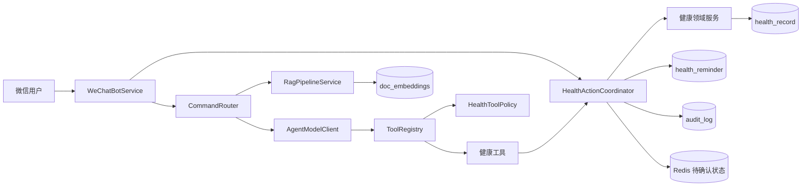
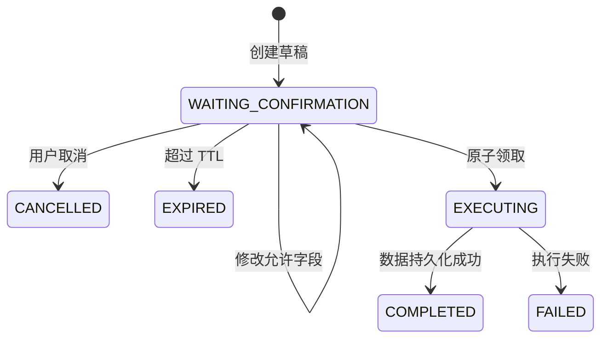

# 架构说明

## 1. 设计目标

项目将大模型视为“不可信但有推理能力的规划者”。模型可以理解意图和提出工具调用，但身份、权限、状态迁移和数据写入必须由后端代码控制。

## 2. 组件关系



### 分层职责

| 层 | 职责 | 不负责 |
| --- | --- | --- |
| 微信渠道 | 获取可信 `userId`、下载图片、发送回复 | 决定工具权限、直接写健康数据 |
| Agent 编排 | 拼接上下文、调用模型、处理 Tool Call 循环 | 信任模型提供的身份和执行结果 |
| 工具安全 | 白名单、风险等级、参数注入、注册检查 | 保存业务状态 |
| HITL | 草稿、确认、取消、领取、完成和失败状态 | 健康领域计算 |
| 领域服务 | 药物、指标、报告、饮食、计划、概览 | 微信协议和模型调用 |
| 持久化 | MySQL、Redis、兼容旧数据 | 决定业务权限 |

## 3. 信任边界

### 渠道身份

工具参数中的用户身份不暴露给模型。`ToolRegistry` 通过 `@CurrentUserId` 将微信会话中的真实身份注入工具调用，缺少注解或渠道身份时拒绝执行。

### 工具权限

`HealthToolPolicy` 是显式白名单：

- `READ_ONLY`：查询概览、解释报告、症状初筛等，可自动执行。
- `CONFIRMATION_REQUIRED`：记录指标、添加药物、保存报告、创建提醒等，只能创建草稿。
- 未登记工具：拒绝注册和调用。

Spring 容器中出现一个带 `@Tool` 的 Bean，并不意味着模型自动获得该能力。

## 4. HITL 状态机



同一草稿只能从 `WAITING_CONFIRMATION` 领取一次，因此重复发送“确认”不会重复写入。Redis 用于跨进程重启恢复；Redis 不可用时退化为当前进程内存。

## 5. 健康数据

`health_record` 为每个渠道用户保存一个 JSON 聚合文档，并通过 `version` 支持更新控制。业务访问统一经过 `HealthRecordStore` 和 `HealthRecordRepository`，不再同时写 JSON 文件和多张业务表。

旧版 `health-data/*.json` 只在数据库记录不存在时读取并导入，成功后数据库成为唯一写入目标。

## 6. 可靠提醒

```text
到期扫描 → 条件更新抢占 RUNNING → 发送微信提醒
       ├─ 成功：ACTIVE + last_triggered_date
       └─ 失败：FAILED + next_retry_at
                    └─ 超过最大次数：DEAD
```

通过状态条件、锁过期时间和每日触发日期避免多实例重复发送。

## 7. 健康知识库

- 只有管理员可以上传、预览和删除。
- 上传限制为 5MB 和明确扩展名白名单。
- 文档切块和向量生成全部成功后才在事务中替换旧版本。
- 检索条件为 `uploader IS NULL OR uploader = 当前用户`。
- 检索缓存键包含 `userId`，避免跨用户缓存污染。
- 用户上传的知识不能被其他用户检索。

## 8. 隐私与可观测性

- 微信入口日志只记录输入/输出长度。
- 图片不永久落盘，临时文件在 `finally` 中删除。
- Agent Trace 中的工具参数和结果只保留脱敏元数据。
- 健康审计只记录动作类型、状态、耗时和异常类型。
- 管理后台需要管理员 JWT，密码使用 BCrypt。

## 9. 已知边界

- 当前没有自动化的真实微信端到端测试。
- RAG 文档内容仍需要可信管理员审核；后续可增加文档 Prompt Injection 扫描和引用展示。
- 当前 JWT 是轻量实现；生产环境建议迁移到 Spring Security Filter Chain 和集中式密钥管理。
- 单机图片缓存和部分去重状态不适用于大规模集群，需要迁移到共享存储。
